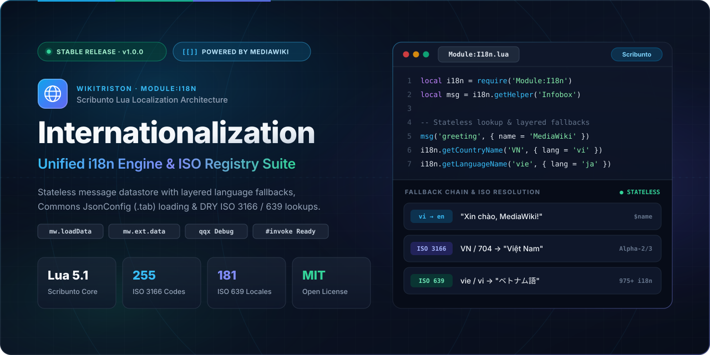
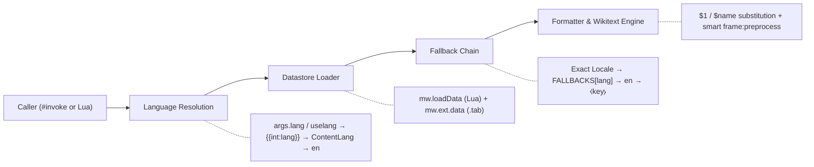

<div align="center">



<br />

[](#stable-release--compatibility)
[](https://www.mediawiki.org/wiki/Extension:Scribunto)
[](https://www.mediawiki.org/wiki/Extension:Scribunto/Lua_reference_manual)
[](#iso--unicode-registries)
[](LICENSE)

<p align="center">
  <strong>A stateless, lightweight internationalization (i18n) framework and DRY ISO / Unicode registry suite for MediaWiki modules.</strong><br />
  Engineered in 100% pure Wikimedia Scribunto Lua with layered language fallbacks, unified alias resolution, Commons <code>JsonConfig</code> (<code>.tab</code>) hybrid loading, and zero-boilerplate template integration.
</p>

<p align="center">
  <a href="#key-features">Features</a> ·
  <a href="#installation--deployment">Deployment</a> ·
  <a href="#quick-start">Quick Start</a> ·
  <a href="#architecture--fallback-pipeline">Architecture</a> ·
  <a href="#api-reference">API Reference</a> ·
  <a href="#iso--unicode-registries">ISO &amp; Unicode Registries</a> ·
  <a href="#stable-release--compatibility">Stable Release</a>
</p>

</div>

---

## Overview

**Internationalization (`Module:I18n`)** is the core localization foundation developed by **WikiTriston** and powered by **MediaWiki**. It provides a unified, stateless datastore API for loading, formatting, and resolving multilingual messages—keeping translation tables cleanly separated from module and template logic.

Beyond standard key-value message localization, the suite ships with built-in, memory-conscious **ISO 3166** (countries, territories & historical codes), **ISO 639** (world languages, ancient languages & language families), **ISO 15924** (modern, historical & ancient writing systems), and **Unicode UCD** (UAX #44 / UAX #24 property, value & block alias) engines synchronized through a single deterministic **`Module:I18n/Alias`** registry.

---

## Key Features

| Capability | Description |
| :--- | :--- |
| **Stateless Datastore Execution** | Every `ds:msg()` call resolves language and source overrides independently—preventing temporary locale switches from leaking across subsequent template or module invocations. |
| **Layered Fallback Chains** | Multi-hop regional and script fallbacks (`zh → zh-hans → zh-hant → en`, `pt-br → pt → en`, `nb/nn → no → en`, `sr-ec/sr-el → sr → en`, `vi → en`) before graceful English fallback. |
| **Smart Hybrid Source Loading** | Resolves short names (`"Foo"` → `Module:Foo/i18n`), subpages, full namespaces, and Wikimedia Commons `JsonConfig` tabular pages (`Data:I18n/*.tab` via `mw.ext.data`). |
| **Dual-Layout Normalization** | Automatically detects and normalizes both **language-first** (`[lang][key]`) and **key-first** (`[key][lang]`) message tables while stripping `qqq` documentation keys. |
| **Flexible Message Formatting** | Supports positional (`$1`, `$2`) and named (`$name`) placeholders, conditional Wikitext auto-preprocessing (`frame:preprocess` only when markup is detected), and `qqx` debug mode (`⧼key⧽`). |
| **Unified Alias & Callback Engine** | `Module:I18n/Alias` provides lazy namespace-isolated indexing, deterministic priority (`canonical > official > name > historical/deprecated > translation > project`), UAX #44 LM3 loose matching, conflict validation, and safe lifecycle callbacks. |
| **Complete ISO & Unicode Suite** | Pure Lua datasets covering **255** ISO 3166 regions (+ **22** reserved/historical codes), **322** ISO 639 languages & families (all **184** ISO 639-1 codes + **138** ISO 639-2/3/5 codes), **182** ISO 15924 scripts, and **81** Unicode properties / **84** code blocks. |

---

## Installation & Deployment

### Requirements

- **MediaWiki** `1.35+` (LTS or latest stable recommended)
- **[Extension:Scribunto](https://www.mediawiki.org/wiki/Extension:Scribunto)** (Lua 5.1 runtime enabled)
- **[Extension:JsonConfig](https://www.mediawiki.org/wiki/Extension:JsonConfig)** *(optional — only required if loading Commons `.tab` datasets via `mw.ext.data`)*

### MediaWiki Namespace Mapping

Deploy the files from this repository to the following `Module:` pages on your MediaWiki instance:

| Repository Path | Target MediaWiki Page | Required | Purpose |
| :--- | :--- | :---: | :--- |
| [`Main/i18n.lua`](Main/i18n.lua) | `Module:I18n` | **Yes** | Core datastore engine, helper closures, and `#invoke` entrypoints |
| [`Main/alias.lua`](Main/alias.lua) | `Module:I18n/Alias` | **Yes\*** | Unified namespace-aware alias registry, precedence solver & event callbacks |
| [`ISO 3166/iso-3166.lua`](ISO%203166/iso-3166.lua) | `Module:I18n/ISO 3166` | Optional | ISO 3166-1 / 3166-3 base registry (255 active + 13 reserved + 9 historical) |
| [`ISO 3166/iso-3166-data.lua`](ISO%203166/iso-3166-data.lua) | `Module:I18n/ISO 3166/tran` | Optional | Localized country & territory translations (105 regions across 12 locales) |
| [`ISO 639/iso-639.lua`](ISO%20639/iso-639.lua) | `Module:I18n/ISO 639` | Optional | ISO 639-1 / 639-2 / 639-3 / 639-5 registry (322 canonical + 7 deprecated) |
| [`ISO 639/iso-639-data.lua`](ISO%20639/iso-639-data.lua) | `Module:I18n/ISO 639/tran` | Optional | Localized language & family names (245 entries across 12 target locales) |
| [`ISO 15924/iso-15924.lua`](ISO%2015924/iso-15924.lua) | `Module:I18n/ISO 15924` | Optional | ISO 15924 writing system registry (182 modern, historical & ancient scripts) |
| [`ISO 15924/iso-15924-data.lua`](ISO%2015924/iso-15924-data.lua) | `Module:I18n/ISO 15924/tran` | Optional | Localized script names (122 scripts across 12 target locales) |
| [`Unicode/unicode.lua`](Unicode/unicode.lua) | `Module:I18n/Unicode` | Optional | Unicode UAX #44 property, value & block alias engine |
| [`Unicode/unicode-data.lua`](Unicode/unicode-data.lua) | `Module:I18n/Unicode/data` | Optional | Pure Lua UCD property, value & hex block range tables |

> [!TIP]
> `Module:I18n` loads the ISO / Alias submodules and `mw.ext.data` inside safe `pcall` guards (`Module:I18n/Alias` is required only when deploying the ISO or Unicode submodules). You can deploy `Module:I18n` standalone or alongside the full ISO & Unicode suite without configuration changes.

### Repository Layout

```text
Internationalization/
├── assets/
│   └── banner.svg                 # 2:1 (1280×640) vector hero & social preview banner
├── Main/
│   ├── i18n.lua                   # Core Module:I18n library
│   └── alias.lua                  # Unified Module:I18n/Alias resolution & callback engine
├── ISO 3166/
│   ├── iso-3166.lua               # Module:I18n/ISO 3166 engine & base registry
│   └── iso-3166-data.lua          # Module:I18n/ISO 3166/tran localized translations
├── ISO 639/
│   ├── iso-639.lua                # Module:I18n/ISO 639 engine & base registry
│   └── iso-639-data.lua           # Module:I18n/ISO 639/tran localized translations
├── ISO 15924/
│   ├── iso-15924.lua              # Module:I18n/ISO 15924 script engine & base registry
│   └── iso-15924-data.lua         # Module:I18n/ISO 15924/tran localized translations
├── Unicode/
│   ├── unicode.lua                # Module:I18n/Unicode UAX #44 property & block engine
│   └── unicode-data.lua           # Module:I18n/Unicode/data UCD alias & block tables
├── tests/
│   └── run_tests.lua              # Offline Lua 5.1 regression & dataset integrity suite
├── LICENSE                        # MIT License
└── README.md                      # Documentation
```

---

## Quick Start

### 1. Define a Translation Submodule

Create `Module:Infobox/i18n` on your wiki. Both **language-first** and **key-first** layouts are normalized automatically, and `qqq` documentation entries are ignored at runtime:

```lua
-- Module:Infobox/i18n (Language-first layout)
return {
    en = {
        greeting = 'Welcome to $1, $name!',
        updated  = "Last updated: '''$1'''",
        author   = 'author',
    },
    vi = {
        greeting = 'Chào mừng đến với $1, $name!',
        updated  = "Cập nhật lần cuối: '''$1'''",
        author   = 'tác giả',
    },
    qqq = {
        greeting = 'Greeting banner. $1 = wiki name, $name = username.',
    },
}
```

<details>
<summary><strong>Alternative: Key-first (inverted) table layout</strong></summary>

```lua
-- Module:Infobox/i18n (Key-first layout — auto-detected)
return {
    greeting = {
        en = 'Welcome to $1, $name!',
        vi = 'Chào mừng đến với $1, $name!',
    },
    updated = {
        en = "Last updated: '''$1'''",
        vi = "Cập nhật lần cuối: '''$1'''",
    },
}
```

</details>

### 2. Consume Messages & ISO Lookups in a Scribunto Module

Use `i18n.getHelper()` for a compact, zero-boilerplate closure, or `i18n.loadMessages()` when combining multiple datastores:

```lua
local i18n = require('Module:I18n')
local msg  = i18n.getHelper('Infobox') -- Resolves to Module:Infobox/i18n

local p = {}

function p.render(frame)
    -- Positional ($1) or named ($name) placeholders + optional per-call lang override
    local header = msg('greeting', { [1] = 'WikiTriston', name = 'Admin', lang = 'vi' })
    -- → "Chào mừng đến với WikiTriston, Admin!"

    -- Built-in ISO 3166, ISO 639 & ISO 15924 localization
    local country  = i18n.getCountryName('VN', { lang = 'vi' })    -- → "Việt Nam"
    local language = i18n.getLanguageName('vie', { lang = 'ja' })  -- → "ベトナム語"
    local script   = i18n.getScriptName('050', { lang = 'vi' })    -- → "Chữ tượng hình Ai Cập"

    return string.format('%s (%s · %s · %s)', header, country, language, script)
end

return p
```

### 3. Invoke Directly from Wikitext Templates

Call `Module:I18n` directly inside Wikitext pages or templates without writing an intermediate Lua wrapper:

```wikitext
<!-- Standard message lookup with positional arguments and explicit locale -->
{{#invoke:I18n|getMsg|Infobox|updated|2026-11-07|lang=vi}}

<!-- Resolve any ISO / Unicode alias to its canonical code -->
{{#invoke:I18n|alias|iso15924|Egyptian_Hieroglyphs}}
<!-- Output: Egyp -->

<!-- Template entrypoint using the activate dispatcher -->
{{#invoke:I18n|main|activate=getMsg|Infobox|updated|2026-11-07}}

<!-- Debug mode: inspect raw message keys -->
{{#invoke:I18n|getMsg|Infobox|updated|lang=qqx}}
<!-- Output: ⧼updated⧽ -->
```

---

## Architecture & Fallback Pipeline



### Smart Source Resolution

`i18n.loadMessages(...)` resolves source identifiers automatically and merges optional Commons `JsonConfig` tabular data (`Data:I18n/<source>.tab`) without overwriting existing Lua keys:

| Input Source String | Resolved Lua Module | Fallback / Merged `.tab` Dataset |
| :--- | :--- | :--- |
| `"Infobox"` | `Module:Infobox/i18n` | `Data:I18n/Infobox.tab` |
| `"Infobox/messages"` | `Module:Infobox/messages` | `Data:I18n/Infobox/messages.tab` |
| `"Module:Shared/i18n"` | `Module:Shared/i18n` | `Data:I18n/Module:Shared/i18n.tab` |
| `"I18n/Common.tab"` | *(Tabular source)* | `Data:I18n/Common.tab` |

### Layered Language Fallbacks

When a translation key is absent in the requested language, `Module:I18n` walks its predefined fallback chain before defaulting to `'en'`:

| Requested Code | Fallback Resolution Chain |
| :--- | :--- |
| `vi` | `vi` → `en` |
| `zh` | `zh` → `zh-hans` → `zh-hant` → `en` |
| `zh-hans` / `zh-hant` | `zh-hans` / `zh-hant` → `zh` → `en` |
| `pt-br` / `pt-pt` | `pt-br` / `pt-pt` → `pt` → `en` |
| `nb` / `nn` | `nb` / `nn` → `no` → `en` |
| `sr-ec` / `sr-el` | `sr-ec` / `sr-el` → `sr` → `en` |
| *Any other valid code* | `<lang>` → `en` → `⧼key⧽` |

---

## API Reference

### `Module:I18n` Top-Level API

| Function | Signature | Description |
| :--- | :--- | :--- |
| `i18n.loadMessages` | `i18n.loadMessages(source1, source2, ...) → Data` | Loads one or more Lua / `.tab` message sources into a stateless `Data` instance defaulting to the user UI language. |
| `i18n.getHelper` | `i18n.getHelper(sourceOrConfig) → function(key, ...)` | Returns a compact message getter closure for a module. Accepts `"Source"` or `{ source = "Source", subpage = "i18n", lang = "vi" }`. |
| `i18n.getMsg` | `i18n.getMsg(frame) → string` | Wikitext `#invoke` handler (`{{#invoke:I18n\|getMsg\|source\|key\|...\|lang=xx}}`). |
| `i18n.alias` | `i18n.alias(frame) → string` | Wikitext `#invoke` handler resolving an alias in a namespace (`{{#invoke:I18n\|alias\|namespace\|input}}`). |
| `i18n.main` | `i18n.main(frame) → string` | Template dispatcher routing `frame.args.activate` (defaults to `getMsg`). |
| `i18n.getLang` | `i18n.getLang(args?) → string` | Resolves active language from `args.lang`, `args.uselang`, `{{int:lang}}`, wiki content language, or `'en'`. |
| `i18n.getCountryName` | `i18n.getCountryName(code, args?) → string` | Resolves an ISO 3166 Alpha-2, Alpha-3, Numeric, historical, or localized alias into a localized country/region name. |
| `i18n.getLanguageName` | `i18n.getLanguageName(code, args?) → string` | Resolves an ISO 639-1, 639-2/T, 639-2/B, 639-3, 639-5, or deprecated code into a localized language/family name. |
| `i18n.getScriptName` | `i18n.getScriptName(code, args?) → string` | Resolves an ISO 15924 Alpha-4, 3-digit numeric, or Unicode `sc` Property Value Alias into a localized script name. |
| `i18n.resolveAlias` | `i18n.resolveAlias(namespace, input) → canonical, kind` | Resolves any alias across `'iso3166'`, `'iso639'`, `'iso15924'`, `'unicode:property'`, or `'unicode:value:<prop>'`. |

### `Data` Instance Methods

```lua
local ds = i18n.loadMessages('Core', 'Infobox')

-- 1. Simple lookup with positional arguments
local text = ds:msg('welcome_user', 'Alice')

-- 2. Advanced stateless lookup (does NOT mutate ds default language or active sources)
local scoped = ds:msg({
    key     = 'welcome_user',
    args    = { 'Alice' },
    lang    = 'zh-hant',
    sources = { 'Infobox' },
})

-- 3. Default language configuration (chainable)
ds:useUserLang()        -- Resolve UI language via {{int:lang}}
ds:useContentLang()     -- Use mw.language.getContentLanguage():getCode()
ds:useLang('vi')        -- Pin default language if valid MediaWiki language code
local active = ds:getLang()

-- 4. Localized template parameter extraction
local authorVal = ds:parameter('author', frame:getParent().args, 'vi')
```

---

## ISO & Unicode Registries

All standards modules follow a strict **DRY architecture** synchronized through **`Module:I18n/Alias`**:

1. **Single Source of Truth (`baseData`)**: Canonical English names, official codes, numeric codes, structural metadata, and historical/deprecated lineage live exclusively in each standard's base module.
2. **Zero-Drift Alias Indexing (`Module:I18n/Alias`)**: Forward and reverse alias indices are built lazily from a single loader per namespace (`iso3166`, `iso639`, `iso15924`, `unicode:property`, `unicode:value:<prop>`) with deterministic precedence (`canonical > official > name > deprecated/historical > translation > project`).
3. **Zero-Duplication Translation Layer (`/tran`)**: Translation submodules omit `'en'` and omit target locales identical to English—falling back to `baseData` automatically.

### ISO 3166 Country, Reserved & Historical Lookup

Supports **255** active entries (**249** officially assigned ISO 3166-1 codes, **5** project-defined UK constituent subdivisions `GB-*`, and **1** user-assigned `XK`), plus **13** exceptionally reserved codes (`EU`, `SU`, `UK`, `EZ`, `UN`, …) and **9** withdrawn ISO 3166-3 historical codes (`ZR` → `CD`, `DD` → `DE`, `YU`, `CS`, `AN`, …):

```lua
local iso3166 = require('Module:I18n/ISO 3166')
local i18n    = require('Module:I18n')

i18n.getCountryName('VN',  { lang = 'vi' })      -- → "Việt Nam"   (Alpha-2)
i18n.getCountryName('VNM', { lang = 'zh' })      -- → "越南"       (Alpha-3 auto-resolved)
i18n.getCountryName('840', { lang = 'zh-hant' }) -- → "美國"       (Numeric auto-resolved)
iso3166.resolve('ZR')                            -- → "CD", "historical" (Zaire → DR Congo)
iso3166.getReserved('EU')                        -- → { name = "European Union", status = "exceptionally-reserved" }
```

### ISO 639 Language, Ancient Language & Family Lookup

Supports **322** canonical codes—all **184** ISO 639-1 Alpha-2 codes, **67** ISO 639-2/3 ancient, historical, macrolanguage, regional & special codes (`grc`, `egy`, `sux`, `akk`, `got`, `lzh`, `cmn`, `yue`, `mtq`, `tyz`, `nut`, `mul`, `und`, `zxx`, `mis`), **71** ISO 639-5 language families (`ine`, `sit`, `mkh`, `map`, `tai`, `roa`, `gem`, `sla`, …), and **7** deprecated mappings (`iw` → `he`, `in` → `id`, `ji` → `yi`, `jw` → `jv`, `mo`/`mol` → `ro`, `sh` → `hbs`):

```lua
local iso639 = require('Module:I18n/ISO 639')
local i18n   = require('Module:I18n')

i18n.getLanguageName('chi', { lang = 'fr' })     -- → "Chinois"                  (639-2/B bibliographic)
i18n.getLanguageName('grc', { lang = 'vi' })     -- → "Tiếng Hy Lạp cổ đại"      (639-2/3 ancient/historical)
i18n.getLanguageName('mkh', { lang = 'vi' })     -- → "Ngữ hệ Nam Á (Môn-Khmer)" (639-5 family)
iso639.resolve('iw')                             -- → "he", "deprecated"
```

### ISO 15924 Script Registry & Unicode UCD Aliases

Supports **182** ISO 15924 scripts (Alpha-4, 3-digit numeric, English/French ISO names, Unicode `sc` Property Value Aliases, writing direction, script lineage, `Script_Extensions`, deprecated `Qaai` → `Zinh`, and Hán-Nôm / CJK Extensions A–I documentation) synchronized with **81** Unicode properties, **10** enumerated/catalog value spaces, and **84** UCD code blocks:

```lua
local iso15924 = require('Module:I18n/ISO 15924')
local U        = require('Module:I18n/Unicode')

iso15924.getName('050',  'vi')                   -- → "Chữ tượng hình Ai Cập" (Egyp)
iso15924.getName('Xsux', 'vi')                   -- → "Chữ hình nêm Sumer-Akkad"
iso15924.resolve('Qaai')                         -- → "Zinh", "deprecated"
iso15924.resolve('Chữ Nôm')                      -- → "Hani", "project"

U.resolveProperty('General Category')            -- → "gc", "official" (UAX #44 LM3)
U.resolveValue('gc', 'uppercase-letter')         -- → "Lu", "official"
U.getBlock('CJK_Ext_B')                          -- → { first = "20000", last = "2A6DF", short = "CJK_Ext_B", ... }
```

---

## Stable Release & Compatibility

> [!IMPORTANT]
> **Current Channel: `v1.0.0` (Stable Release)** — Public entrypoints (`loadMessages`, `getHelper`, `getMsg`, `alias`, `main`, `getLang`, `getCountryName`, `getLanguageName`, `getScriptName`, `resolveAlias`, and `Data` methods) are production-ready and locked for backward compatibility across WikiTriston modules.

### Engineering & Scribunto Guarantees

- **100% Pure Lua 5.1 & `mw.ustring` Safe**: Zero external build/CLI dependencies; avoids Lua 5.2+ incompatibilities and uses UTF-8-aware `mw.ustring` slicing rather than unsafe byte-level `gsub` function captures.
- **Stateless Concurrency Safety**: `Data:msg()` computes active locales and source subsets in local call frames rather than mutating shared module tables.
- **Minimal Parser Overhead**: Wikitext preprocessing (`frame:preprocess`) is triggered selectively only when structural Wikitext tokens (`[[...]]`, `{{...}}`, `''`, headings, lists, or HTML tags) are present in a resolved string.
- **Graceful Degradation**: Missing keys never throw fatal script errors in articles—returning clean MediaWiki `⧼key⧽` markers escaped via `mw.text.nowiki`.

---

## Contributing

Contributions, new fallback rules, and expanded `/tran` localization entries are welcome:

1. **Preserve DRY Rules**: In `ISO 3166/iso-3166-data.lua`, `ISO 639/iso-639-data.lua`, and `ISO 15924/iso-15924-data.lua`, use canonical keys (`UPPERCASE` Alpha-2 for ISO 3166, `lowercase` Alpha-2/Alpha-3 for ISO 639, `Titlecase` Alpha-4 for ISO 15924) and omit translations that are identical to the canonical English `baseData` name.
2. **Verify Zero Ambiguity**: Run `lua5.1 tests/run_tests.lua` and ensure `.validate().ok == true` across all namespaces.
3. **Maintain Pure Scribunto Compatibility**: Restrict all repository files to sandboxed Lua 5.1 modules without external runtime dependencies.

---

## License

Released under the [MIT License](LICENSE). Copyright © 2026 **WikiTriston**.

<div align="center">
  <sub>Built with precision for the wiki ecosystem · <strong>Powered by MediaWiki &amp; Scribunto Lua</strong></sub>
</div>
