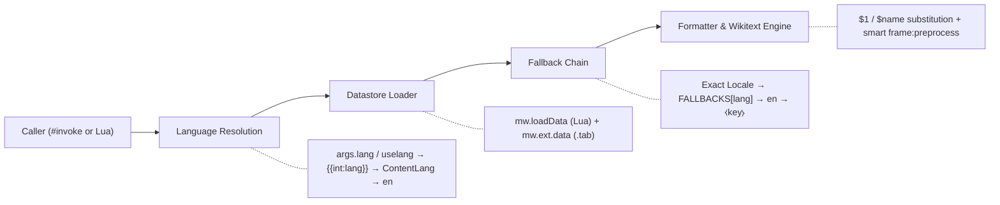

<div align="center">


<br />

[](#stable-release--compatibility)
[](https://www.mediawiki.org/wiki/Extension:Scribunto)
[](https://www.mediawiki.org/wiki/Extension:Scribunto/Lua_reference_manual)
[](#iso-3166--iso-639-registries)
[](LICENSE)

<p align="center">
  <strong>A stateless, lightweight internationalization (i18n) framework and DRY ISO registry suite for MediaWiki modules.</strong><br />
  Engineered for Wikimedia Scribunto Lua with layered language fallbacks, Commons <code>JsonConfig</code> (<code>.tab</code>) hybrid loading, and zero-boilerplate template integration.
</p>

<p align="center">
  <a href="#key-features">Features</a> ·
  <a href="#installation--deployment">Deployment</a> ·
  <a href="#quick-start">Quick Start</a> ·
  <a href="#architecture--fallback-pipeline">Architecture</a> ·
  <a href="#api-reference">API Reference</a> ·
  <a href="#iso-3166--iso-639-registries">ISO Registries</a> ·
  <a href="#stable-release--compatibility">Stable Release</a>
</p>

</div>

---

## Overview

**Internationalization (`Module:I18n`)** is the core localization foundation developed by **WikiTriston** and powered by **MediaWiki**. It provides a unified, stateless datastore API for loading, formatting, and resolving multilingual messages—keeping translation tables cleanly separated from module and template logic.

Beyond standard key-value message localization, the suite ships with built-in, memory-conscious **ISO 3166** (countries & territories) and **ISO 639** (world languages) lookup engines designed strictly around the **DRY (Don't Repeat Yourself)** principle.

---

## Key Features

| Capability | Description |
| :--- | :--- |
| **Stateless Datastore Execution** | Every `ds:msg()` call resolves language and source overrides independently—preventing temporary locale switches from leaking across subsequent template or module invocations. |
| **Layered Fallback Chains** | Multi-hop regional and script fallbacks (`zh → zh-hans → zh-hant → en`, `pt-br → pt → en`, `nb/nn → no → en`, `sr-ec/sr-el → sr → en`, `vi → en`) before graceful English fallback. |
| **Smart Hybrid Source Loading** | Resolves short names (`"Foo"` → `Module:Foo/i18n`), subpages, full namespaces, and Wikimedia Commons `JsonConfig` tabular pages (`Data:I18n/*.tab` via `mw.ext.data`). |
| **Dual-Layout Normalization** | Automatically detects and normalizes both **language-first** (`[lang][key]`) and **key-first** (`[key][lang]`) message tables while stripping `qqq` documentation keys. |
| **Flexible Message Formatting** | Supports positional (`$1`, `$2`) and named (`$name`) placeholders, conditional Wikitext auto-preprocessing (`frame:preprocess` only when markup is detected), and `qqx` debug mode (`⧼key⧽`). |
| **DRY ISO 3166 & 639 Suite** | Built-in reverse-indexed lookups for **255** ISO 3166-1 regions (Alpha-2, Alpha-3, Numeric) and **181** ISO 639 languages (639-1, 639-2/T, 639-2/B, 639-3) with **975+** translations across 12 locales. |

---

## Installation & Deployment

### Requirements

- **MediaWiki** `1.35+` (LTS or latest stable recommended)
- **[Extension:Scribunto](https://www.mediawiki.org/wiki/Extension:Scribunto)** (Lua 5.1 runtime enabled)
- **[Extension:JsonConfig](https://www.mediawiki.org/wiki/Extension:JsonConfig)** *(optional — only required if loading Commons `.tab` datasets via `mw.ext.data`)*

### MediaWiki Namespace Mapping

Deploy the files from this repository to the following `Module:` pages on your MediaWiki instance:

| Repository Path | Target MediaWiki Page | Required | Purpose |
| :--- | :--- | :---: | :--- |
| [`Main/i18n.lua`](Main/i18n.lua) | `Module:I18n` | **Yes** | Core datastore engine, helper closures, and `#invoke` entrypoints |
| [`ISO 3166/iso-3166.lua`](ISO%203166/iso-3166.lua) | `Module:I18n/ISO 3166` | Optional | ISO 3166-1 base registry (255 entries; Alpha-2, Alpha-3 & Numeric index) |
| [`ISO 3166/iso-3166-data.lua`](ISO%203166/iso-3166-data.lua) | `Module:I18n/ISO 3166/tran` | Optional | Localized country/region translations (DRY overlay) |
| [`ISO 639/iso-639.lua`](ISO%20639/iso-639.lua) | `Module:I18n/ISO 639` | Optional | ISO 639-1 / 639-2 / 639-3 base registry (181 entries & linguistic metadata) |
| [`ISO 639/iso-639-data.lua`](ISO%20639/iso-639-data.lua) | `Module:I18n/ISO 639/tran` | Optional | Localized language names (975+ translations across 12 target locales) |

> [!TIP]
> `Module:I18n` loads the ISO submodules and `mw.ext.data` inside safe `pcall` guards. You can deploy `Module:I18n` standalone or alongside the full ISO registry suite without configuration changes.

### Repository Layout

```text
Internationalization/
├── assets/
│   └── banner.svg               # 2:1 (1280×640) vector hero & social preview banner
├── Main/
│   └── i18n.lua                 # Core Module:I18n library
├── ISO 3166/
│   ├── iso-3166.lua             # Module:I18n/ISO 3166 engine & base registry
│   └── iso-3166-data.lua        # Module:I18n/ISO 3166/tran localized translations
├── ISO 639/
│   ├── iso-639.lua              # Module:I18n/ISO 639 engine & base registry
│   └── iso-639-data.lua         # Module:I18n/ISO 639/tran localized translations
├── LICENSE                      # MIT License
└── README.md                    # Documentation
```

---

## Quick Start

### 1. Define a Translation Submodule

Create `Module:Infobox/i18n` on your wiki. Both **language-first** and **key-first** layouts are normalized automatically, and `qqq` documentation entries are ignored at runtime:

```lua
-- Module:Infobox/i18n (Language-first layout)
return {
    en = {
        greeting = 'Welcome to $1, $name!',
        updated  = "Last updated: '''$1'''",
        author   = 'author',
    },
    vi = {
        greeting = 'Chào mừng đến với $1, $name!',
        updated  = "Cập nhật lần cuối: '''$1'''",
        author   = 'tác giả',
    },
    qqq = {
        greeting = 'Greeting banner. $1 = wiki name, $name = username.',
    },
}
```

<details>
<summary><strong>Alternative: Key-first (inverted) table layout</strong></summary>

```lua
-- Module:Infobox/i18n (Key-first layout — auto-detected)
return {
    greeting = {
        en = 'Welcome to $1, $name!',
        vi = 'Chào mừng đến với $1, $name!',
    },
    updated = {
        en = "Last updated: '''$1'''",
        vi = "Cập nhật lần cuối: '''$1'''",
    },
}
```

</details>

### 2. Consume Messages in a Scribunto Module

Use `i18n.getHelper()` for a compact, zero-boilerplate closure, or `i18n.loadMessages()` when combining multiple datastores:

```lua
local i18n = require('Module:I18n')
local msg  = i18n.getHelper('Infobox') -- Resolves to Module:Infobox/i18n

local p = {}

function p.render(frame)
    -- Positional ($1) or named ($name) placeholders + optional per-call lang override
    local header = msg('greeting', { [1] = 'WikiTriston', name = 'Admin', lang = 'vi' })
    -- → "Chào mừng đến với WikiTriston, Admin!"

    -- Built-in ISO 3166 & ISO 639 localization
    local country  = i18n.getCountryName('VN', { lang = 'vi' })   -- → "Việt Nam"
    local language = i18n.getLanguageName('vie', { lang = 'ja' }) -- → "ベトナム語"

    return string.format('%s (%s · %s)', header, country, language)
end

return p
```

### 3. Invoke Directly from Wikitext Templates

Call `Module:I18n` directly inside Wikitext pages or templates without writing an intermediate Lua wrapper:

```wikitext
<!-- Standard message lookup with positional arguments and explicit locale -->
{{#invoke:I18n|getMsg|Infobox|updated|2026-11-07|lang=vi}}

<!-- Template entrypoint using the activate dispatcher -->
{{#invoke:I18n|main|activate=getMsg|Infobox|updated|2026-11-07}}

<!-- Debug mode: inspect raw message keys -->
{{#invoke:I18n|getMsg|Infobox|updated|lang=qqx}}
<!-- Output: ⧼updated⧽ -->
```

---

## Architecture & Fallback Pipeline



### Smart Source Resolution

`i18n.loadMessages(...)` resolves source identifiers automatically and merges optional Commons `JsonConfig` tabular data (`Data:I18n/<source>.tab`) without overwriting existing Lua keys:

| Input Source String | Resolved Lua Module | Fallback / Merged `.tab` Dataset |
| :--- | :--- | :--- |
| `"Infobox"` | `Module:Infobox/i18n` | `Data:I18n/Infobox.tab` |
| `"Infobox/messages"` | `Module:Infobox/messages` | `Data:I18n/Infobox/messages.tab` |
| `"Module:Shared/i18n"` | `Module:Shared/i18n` | `Data:I18n/Module:Shared/i18n.tab` |
| `"I18n/Common.tab"` | *(Tabular source)* | `Data:I18n/Common.tab` |

### Layered Language Fallbacks

When a translation key is absent in the requested language, `Module:I18n` walks its predefined fallback chain before defaulting to `'en'`:

| Requested Code | Fallback Resolution Chain |
| :--- | :--- |
| `vi` | `vi` → `en` |
| `zh` | `zh` → `zh-hans` → `zh-hant` → `en` |
| `zh-hans` / `zh-hant` | `zh-hans` / `zh-hant` → `zh` → `en` |
| `pt-br` / `pt-pt` | `pt-br` / `pt-pt` → `pt` → `en` |
| `nb` / `nn` | `nb` / `nn` → `no` → `en` |
| `sr-ec` / `sr-el` | `sr-ec` / `sr-el` → `sr` → `en` |
| *Any other valid code* | `<lang>` → `en` → `⧼key⧽` |

---

## API Reference

### `Module:I18n` Top-Level API

| Function | Signature | Description |
| :--- | :--- | :--- |
| `i18n.loadMessages` | `i18n.loadMessages(source1, source2, ...) → Data` | Loads one or more Lua / `.tab` message sources into a stateless `Data` instance defaulting to the user UI language. |
| `i18n.getHelper` | `i18n.getHelper(sourceOrConfig) → function(key, ...)` | Returns a compact message getter closure for a module. Accepts `"Source"` or `{ source = "Source", subpage = "i18n", lang = "vi" }`. |
| `i18n.getMsg` | `i18n.getMsg(frame) → string` | Wikitext `#invoke` handler (`{{#invoke:I18n\|getMsg\|source\|key\|...\|lang=xx}}`). |
| `i18n.main` | `i18n.main(frame) → string` | Template dispatcher routing `frame.args.activate` (defaults to `getMsg`). |
| `i18n.getLang` | `i18n.getLang(args?) → string` | Resolves active language from `args.lang`, `args.uselang`, `{{int:lang}}`, wiki content language, or `'en'`. |
| `i18n.getCountryName` | `i18n.getCountryName(code, args?) → string` | Resolves an ISO 3166 Alpha-2, Alpha-3, or Numeric country code into a localized name. |
| `i18n.getLanguageName` | `i18n.getLanguageName(code, args?) → string` | Resolves an ISO 639-1 or ISO 639-2/3 language code into a localized name. |

### `Data` Instance Methods

```lua
local ds = i18n.loadMessages('Core', 'Infobox')

-- 1. Simple lookup with positional arguments
local text = ds:msg('welcome_user', 'Alice')

-- 2. Advanced stateless lookup (does NOT mutate ds default language or active sources)
local scoped = ds:msg({
    key     = 'welcome_user',
    args    = { 'Alice' },
    lang    = 'zh-hant',
    sources = { 'Infobox' },
})

-- 3. Default language configuration (chainable)
ds:useUserLang()        -- Resolve UI language via {{int:lang}}
ds:useContentLang()     -- Use mw.language.getContentLanguage():getCode()
ds:useLang('vi')        -- Pin default language if valid MediaWiki language code
local active = ds:getLang()

-- 4. Localized template parameter extraction
local authorVal = ds:parameter('author', frame:getParent().args, 'vi')
```

---

## ISO 3166 & ISO 639 Registries

Both ISO engines follow a strict **DRY architecture** to minimize `mw.loadData` / `require` memory overhead inside Scribunto's Lua heap:

1. **Single Source of Truth (`baseData`)**: Canonical English names, official ISO names (`isoname`), aliases (`altnames`), linguistic metadata (`scope`, `type`), and auto-generated Alpha-3 / Numeric reverse lookup tables live exclusively in the base module.
2. **Zero-Duplication Translation Layer (`/tran`)**: Translation submodules omit `'en'` and omit any target language whose localized name is identical to English—falling back to `baseData` automatically.

### ISO 3166 Country & Region Lookup

Supports **255** entries including sovereign states, dependent territories, UK constituent countries (`GB-ENG`, `GB-SCT`, `GB-WLS`, `GB-NIR`, `GB-EAW`), and Kosovo (`XK`):

```lua
local i18n = require('Module:I18n')

i18n.getCountryName('VN',  { lang = 'vi' })      -- → "Việt Nam"   (Alpha-2)
i18n.getCountryName('VNM', { lang = 'zh' })      -- → "越南"       (Alpha-3 auto-resolved)
i18n.getCountryName('840', { lang = 'zh-hant' }) -- → "美國"       (Numeric auto-resolved)
i18n.getCountryName('AD',  { lang = 'vi' })      -- → "Andorra"    (DRY English fallback)
```

### ISO 639 Language Lookup & Metadata

Supports **181** ISO 639-1 entries with automatic reverse indexing for both **ISO 639-2/T & 639-3** terminological codes (`vie`, `zho`, `deu`, `fra`) and **ISO 639-2/B** bibliographic codes (`chi`, `ger`, `fre`, `tib`), backed by **975+** localized names across `ar`, `de`, `es`, `fr`, `it`, `ja`, `ko`, `pt`, `ru`, `vi`, `zh`, and `zh-hant`:

```lua
local iso639 = require('Module:I18n/ISO 639')
local i18n   = require('Module:I18n')

-- Via Module:I18n (automatically passes FALLBACKS chain)
i18n.getLanguageName('vi',  { lang = 'vi' })      -- → "Tiếng Việt"
i18n.getLanguageName('chi', { lang = 'fr' })      -- → "Chinois"     (639-2/B bibliographic)
i18n.getLanguageName('jpn', { lang = 'ko' })      -- → "일본어"       (639-2/T & 639-3)

-- Direct metadata inspection for infoboxes & linguistic modules
local meta = iso639.getData('zh')
-- → { alpha3 = 'zho', alpha3B = 'chi', name = 'Chinese', scope = 'M', type = 'L' }
--   scope: 'I' (Individual) | 'M' (Macrolanguage) | 'S' (Special)
--   type : 'L' (Living) | 'H' (Historical) | 'C' (Constructed) | 'A' (Ancient)

local codes = iso639.getAllCodes() -- Sorted list of all 181 Alpha-2 language codes
```

---

## Stable Release & Compatibility

> [!IMPORTANT]
> **Current Channel: `v1.0.0` (Stable Release)** — Public entrypoints (`loadMessages`, `getHelper`, `getMsg`, `main`, `getLang`, `getCountryName`, `getLanguageName`, and `Data` methods) are production-ready and locked for backward compatibility across WikiTriston modules.

### Engineering & Scribunto Guarantees

- **Lua 5.1 & `mw.ustring` Safe**: Avoids Lua 5.2+ incompatibilities and uses UTF-8-aware `mw.ustring` slicing rather than unsafe byte-level `gsub` function captures.
- **Stateless Concurrency Safety**: `Data:msg()` computes active locales and source subsets in local call frames rather than mutating shared module tables.
- **Minimal Parser Overhead**: Wikitext preprocessing (`frame:preprocess`) is triggered selectively only when structural Wikitext tokens (`[[...]]`, `{{...}}`, `''`, headings, lists, or HTML tags) are present in a resolved string.
- **Graceful Degradation**: Missing keys never throw fatal script errors in articles—returning clean MediaWiki `⧼key⧽` markers escaped via `mw.text.nowiki`.

---

## Contributing

Contributions, new fallback rules, and expanded `/tran` localization entries are welcome:

1. **Preserve DRY Rules**: In `ISO 3166/iso-3166-data.lua` and `ISO 639/iso-639-data.lua`, use Alpha-2 keys (`UPPERCASE` for ISO 3166, `lowercase` for ISO 639) and omit translations that are identical to the canonical English `baseData` name.
2. **Keep Lookups Stateless**: Never mutate module-level tables or `mw.loadData` references at runtime.
3. **Maintain Scribunto Compatibility**: Restrict syntax and standard library usage to Scribunto's sandboxed Lua 5.1 environment.

---

## License

Released under the [MIT License](LICENSE). Copyright © 2026 **WikiTriston**.

<div align="center">
  <sub>Built with precision for the wiki ecosystem · <strong>Powered by MediaWiki &amp; Scribunto Lua</strong></sub>
</div>
